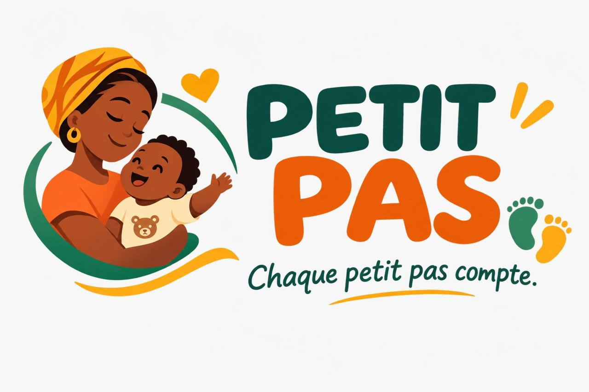

# 🇹🇬 Petit Pas — *« Chaque petit pas compte. »*

  

**Petit Pas** est un passeport numérique de santé maternelle, néonatale et infantile **100% hors-ligne** associé à un assistant vocal multilingue (**Français**, **Eʋegbe / Éwé**, **Kabɩyɛ / Kabyè**, **English**), conçu pour les familles, les sages-femmes et les Centres Médico-Sociaux (CMS) au Togo.

---

## 🌐 Liens Directs (Démo Web, Antigravity & Application)

- **🚀 Ouvrir directement dans Antigravity IDE (1 clic)** : `antigravity://vscode.git/clone?url=https%3A%2F%2Fgithub.com%2Ftrinova%2Fpetit-pas.git`
- **Démo Web Interactive (GitHub Pages)** : [**https://trinova.github.io/petit-pas/**](https://trinova.github.io/petit-pas/)
- **Émulateur Android en direct (Google AI Studio)** : [**Ouvrir Petit Pas dans AI Studio**](https://ais-pre-wqa3p3mdo7kg733kcrf4tr-579195026251.europe-west2.run.app)
- **Code Source GitHub** : [**https://github.com/trinova/petit-pas**](https://github.com/trinova/petit-pas)

---

## ✨ Fonctionnalités Principales

1. **Mode 100% Hors-ligne & Souveraineté Locale (Room SQLite AES-256)** :
   - Fonctionne sans forfait internet ni compte cloud obligatoire (*Mode 100% Anonyme* disponible).
   - Partage de la fiche médicale au CMS par **Bluetooth**, **QR Code hors-ligne**, **Wi-Fi Direct** ou **Export PDF A4 officiel**.
2. **Accessibilité Vocale Multilingue (`Français`, `Eʋegbe`, `Kabɩyɛ`, `English`)** :
   - Synthèse vocale intégrée avec vitesse d'élocution **0.8x Posé & Calme** adaptée aux mamans peu alphabétisées.
   - Transcription bilingue synchronisée mot à mot (*« Nyasia dze edzi nyuie »*).
3. **Carnet de Santé Pédiatrique & Courbe OMS** :
   - Suivi biométrique complet (Poids, Taille, Périmètre Crânien, Température) sur la courbe de croissance OMS.
   - Calendrier vaccinal national **PEV Togo** interactif et mémo vocal de la sage-femme (**Dr. Akouavi Mensah • CMS Adidogomé**).
4. **Urgence Pédiatrique SAMU 118 (GSM Direct)** :
   - Liaison directe 24h/24 vers le **118**, traduction vocale instantanée des consignes du médecin régulateur, et envoi de la **Fiche Rapide Enfant par SMS**.
